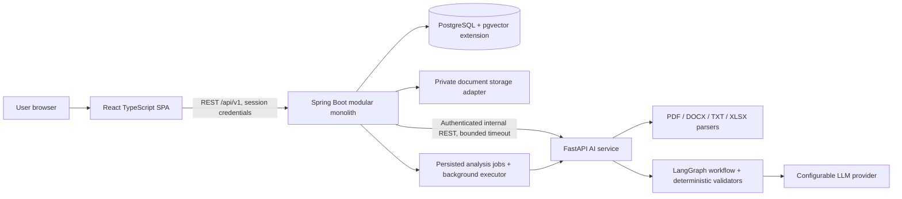
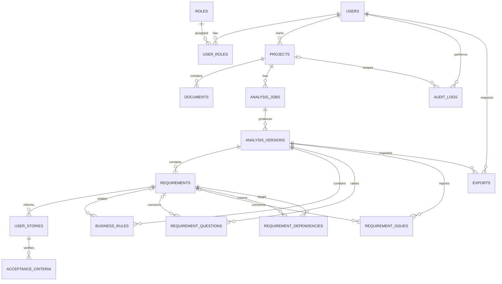

# AI Requirement Analyzer: Foundation Design

Status: Proposal for review. Implementation begins after approval.

## 1. Product Scope

AI Requirement Analyzer is a multi-user SaaS application for turning project descriptions and uploaded PDF, DOCX, TXT, and XLSX files into traceable, structured software requirements. AI output is always a draft: a human must review, edit, approve, or reject it. Spring Boot owns business records; the Python service analyzes input and returns validated structured results.

### In scope

- Account registration, login, profile, roles, and project-level authorization.
- Project and document lifecycle management.
- Asynchronous analysis with progress, retry, cancellation, and history.
- Requirements, stories, acceptance criteria, rules, issues, questions, and prioritization recommendations.
- Human review, audit/version history, and JSON/PDF/Excel exports.
- Responsive web application, PostgreSQL persistence, local development with Docker Compose, automated tests, and operational documentation.

### Out of scope for the first release

- Organization/workspace tenancy, external identity providers, billing, collaborative real-time editing, and customer-managed object storage.
- Autonomous AI actions that change approved business records.
- A promise of particular extraction accuracy; AI findings are recommendations that require review.

## 2. Decisions Needed Before Implementation

These are proposed defaults, not hidden assumptions. Please confirm or change them before Milestone 1.

| Decision | Proposed default | Reason |
|---|---|---|
| Account tenancy | Each user owns their projects; ADMIN has administrative capabilities but does not silently gain project-content access | Matches the stated ownership model and least privilege |
| Refresh tokens | Short-lived JWT access token plus rotating, revocable refresh token stored hashed server-side; web client keeps tokens in secure HttpOnly cookies | Supports logout/revocation and avoids persistent JavaScript-readable credentials |
| Initial admin | No public role escalation; provide a documented one-time bootstrap mechanism controlled by environment configuration | Avoids privilege assignment during public registration |
| File storage | Local filesystem outside web roots behind a storage interface; Docker volume in development | Secure, replaceable by S3-compatible storage later |
| Analysis queue | Persisted analysis job table and bounded Spring-managed background executor for the first release | Keeps Java authoritative and avoids adding a broker before scale requires one |
| AI provider | Provider interface with configurable OpenAI-compatible HTTP provider and mock provider for tests; no key required to run tests | Avoids vendor lock-in and supports deterministic development |
| Analysis retry | New analysis attempt/version linked to the prior job; bounded retries for transient internal/provider failures; explicit user retry after terminal failure | Preserves history and makes retries idempotent |
| Deletion/retention | Archive projects first; hard deletion is owner-authorized and cascades only where safe; document and audit retention policy must be configurable | The prompt requires deletion policies but does not define legal retention periods |
| API pagination | Page-number pagination with stable sorting and a bounded maximum page size | Simple and consistent for the first release |
| Diagram and PDF output | Mermaid for architecture/ER documentation; server-side PDF export after the core JSON workflow works | Keeps initial implementation focused and testable |

## 3. Actors and Permissions

| Actor | Permissions |
|---|---|
| Anonymous visitor | Register, log in, view public landing page |
| USER | Manage own profile; create/read/update/archive own projects; manage their project documents; start and inspect analyses; review and edit generated content; answer questions; export their project data |
| ADMIN | Administrative account/status and system-level functions; project content is not visible unless separately granted ownership/access |
| Internal Spring service | Validate requests, enforce ownership, persist domain records, dispatch jobs, call the authenticated AI service, and record audit events |
| AI service | Parse submitted content and produce analysis response for the requesting job; cannot directly create or modify core business records |

Authorization is checked on every project-scoped operation, including nested documents and analysis results. A UUID is not an authorization mechanism. Public registration always creates USER accounts.

## 4. Use Cases

1. Register an account, log in, refresh a session, and log out.
2. View/update profile and account status.
3. Create, list, view, update, archive, and (subject to retention policy) delete a project.
4. Upload, list, inspect, download, and delete an authorized project document.
5. Submit project text and/or selected documents for analysis.
6. Track queued/processing/completed/failed/cancelled analysis jobs; retry eligible failures or cancel active work.
7. Inspect extracted requirements with source references, confidence, type, priority, and status.
8. Edit, manually add, approve, or reject a requirement while retaining original AI output and audit history.
9. Inspect/edit stories and acceptance criteria associated with requirements.
10. Inspect business rules and possible rule conflicts without silently resolving them.
11. Review validation issues, missing-information questions, and prioritization recommendations; answer questions and request a revised analysis.
12. View analysis versions/history and export a selected analysis as JSON, PDF, or Excel.

## 5. Functional Requirements

| ID | Requirement |
|---|---|
| FR-01 | The system shall register users, authenticate credentials, issue and revoke sessions, and enforce role and account-status checks. |
| FR-02 | The system shall restrict each user to projects and related data they are authorized to access. |
| FR-03 | A user shall create, view, update, archive, and request deletion of projects with validated name, description, domain, owner, timestamps, and status. |
| FR-04 | A user shall upload supported PDF, DOCX, TXT, and XLSX documents with size, MIME/content, extension, sanitized-name, duplicate, and ownership checks. |
| FR-05 | The system shall store files outside public web paths and track document processing status and metadata without requiring the AI service to own document records. |
| FR-06 | A user shall submit project text and/or authorized documents for asynchronous analysis and receive a job identifier. |
| FR-07 | The system shall expose job status, timestamps, safe error details, cancellation, idempotency, and eligible retry operations. |
| FR-08 | Analysis shall return typed functional, non-functional, business, and technical-constraint requirements, plus actors, use cases, dependencies, and source references where available. |
| FR-09 | Generated requirements shall include type, priority recommendation, confidence, status, source traceability, and timestamps; source locations or quotations shall not be fabricated. |
| FR-10 | The system shall generate linked user stories, testable acceptance criteria, business rules, validation issues, and missing-information questions. |
| FR-11 | The system shall identify possible duplicates, contradictions, ambiguity, incompleteness, missing actors/rules, unclear criteria, and feasibility concerns, distinguishing suggestions from verified deterministic findings. |
| FR-12 | AI recommendations shall not overwrite user decisions or mark content approved. |
| FR-13 | Users shall edit, manually add, approve, reject, and answer questions; every change shall preserve original content, prior/current state, actor, action, and timestamp. |
| FR-14 | Users shall view analysis versions and safely retry eligible failures without duplicating an accepted request. |
| FR-15 | Users shall export authorized analysis content in JSON, PDF, and Excel with project, analysis-version, and export-time metadata. |
| FR-16 | The system shall provide paginated, searchable/filterable results where applicable, consistent errors, and API documentation. |

## 6. Non-Functional Requirements

- Security: BCrypt/Argon2 password hashing; revocable credentials; least-privilege authorization; request validation; upload content inspection and size limits; internal service authentication; restricted CORS; secrets only in environment/secret stores; no passwords, tokens, or document bodies in logs.
- Integrity: PostgreSQL constraints and transactions protect relationships; Spring is authoritative; AI output is schema-validated before persistence; human edits are versioned and audited.
- Reliability: bounded background concurrency, timeouts, retry only for transient failures, idempotency keys, terminal job states, and no duplicate processing for repeated submissions.
- Maintainability: separate frontend, Java backend, and Python AI service; feature-oriented packages; DTO boundaries; deterministic validation wherever possible; provider-independent AI interface.
- Performance: paginated collection APIs, indexed foreign keys/status/time lookups, bounded upload and analysis sizes, and no long-running AI call on a user-facing request thread.
- Usability: responsive layouts, visible loading/empty/error states, accessible form controls, and clear separation between AI suggestions and human-approved decisions.
- Observability: correlation IDs across services, structured logs, job timing/error metadata, and health/readiness endpoints without exposing secrets.
- Testability: Java unit/integration/security tests, Python parser/workflow tests with mocked LLM, frontend form/workflow tests, and a small set of end-to-end user journeys.
- Portability: Docker-based local setup, environment-based configuration, documented migrations, and replaceable local object storage/provider adapters.

## 7. Architecture



Data flow: the frontend submits to Spring; Spring validates ownership/input and persists a job; a background worker sends a minimal, authenticated request to Python; Python extracts/processes content and returns Pydantic-validated JSON; Spring validates the response and persists a new analysis version and draft records; the frontend polls job status and presents the drafts for human review. Python does not write business tables. Uploaded content is untrusted data and is never treated as instructions; no tools with side effects are exposed to the model.

### Technology-separated repositories/directories

The root will contain three independently buildable codebases, shared orchestration, and product documentation:

```text
requirement-analyzer/
  requirement-analyzer-frontend/   # React, TypeScript, Vite, Tailwind
  requirement-analyzer-backend/    # Java 21, Spring Boot, Maven, Flyway
  requirement-analyzer-ai-service/ # Python 3.12+, FastAPI, LangGraph
  docs/                            # SRS, architecture, API and operations docs
  docker-compose.yml               # local integration environment
  .env.example                     # names/placeholders only; never secrets
```

Each codebase owns its Dockerfile, tests, and README. PostgreSQL is provisioned by Compose for local development. Dependency versions will be selected and compatibility-checked when each codebase is scaffolded.

## 8. Data Model and Relationships

All primary keys are UUIDs. Mutable records use `created_at` and `updated_at` in UTC. Foreign keys are indexed; child business records are scoped through their project/analysis relationship. User deletion is restricted or anonymized according to the final retention policy rather than cascading away audit evidence.



Key design choices:

- `analysis_jobs` represent execution attempts and status; `analysis_versions` are immutable snapshots of successful outputs. A retry creates a new job/version rather than erasing prior results.
- Requirements and related generated records belong to an analysis version. User edits create revision/audit records and do not destroy the original AI-generated values.
- Source references store only evidence actually returned by parsers (document ID, page/section/offset where known, and carefully bounded excerpts if retention policy allows). No guessed page number is accepted.
- `requirement_dependencies` is a directed relation with a check against self-reference and uniqueness for each pair.
- `audit_logs` capture actor/action/time and before/after state needed for review; avoid logging secrets or full source documents.
- `roles`/`user_roles` allow role evolution while account status remains on `users`.
- `pgvector` is an optional capability, not a launch dependency; duplicate checks can initially use deterministic normalized text and embeddings can be introduced when justified.

Initial normalized entities: `users`, `roles`, `user_roles`, `projects`, `documents`, `analysis_jobs`, `requirements`, `user_stories`, `acceptance_criteria`, `business_rules`, `requirement_questions`, `requirement_issues`, `requirement_dependencies`, `analysis_versions`, `audit_logs`, and `exports`. Migrations will add explicit constraints for enum-like values, file sizes, confidence range, ownership, idempotency, and uniqueness.

## 9. API Contract Proposal

Base path: `/api/v1`. JSON uses camelCase. IDs are UUIDs. Timestamps are ISO-8601 UTC. All project/analysis/resource routes require an authenticated user and ownership authorization unless explicitly designated administrative. Collections use `page`, `size`, and `sort`, return `content`, `page`, `size`, `totalElements`, and `totalPages`, and enforce a maximum size.

| Method and path | Request | Success | Main validation/errors |
|---|---|---|---|
| POST `/auth/register` | `{email,password,displayName}` | 201 user profile | email format/uniqueness, password policy; 409 duplicate |
| POST `/auth/login` | `{email,password}` | 200 profile; session cookies | invalid credentials 401, disabled account 403 |
| POST `/auth/refresh` | refresh cookie | 204 rotated cookies | invalid/revoked/expired refresh 401 |
| POST `/auth/logout` | refresh cookie | 204; cookies cleared | idempotent logout |
| GET/PATCH `/users/me` | profile fields for PATCH | 200 profile | field validation; never return credential material |
| POST `/projects` | `{name,description,domain}` | 201 project | required name/limits; 400 |
| GET `/projects` | page/filter query | 200 page | caller's projects only |
| GET/PUT/DELETE `/projects/{id}` | project DTO for PUT | 200/204 | 404 for absent or inaccessible resource; archive/delete policy |
| POST `/projects/{id}/documents` | multipart file | 202 document metadata | size/extension/MIME/content checks, duplicate 409, unsupported 415 |
| GET `/projects/{id}/documents` | page query | 200 page | ownership; pagination |
| GET/DELETE `/documents/{id}` | none | metadata/download or 204 | ownership; safe content disposition; processing/deletion rules |
| POST `/projects/{id}/analyses` | `{text?,documentIds?,idempotencyKey}` | 202 `{analysisJobId,status}` | require text or authorized docs; bounded input; duplicate key returns original job |
| GET `/analyses/{id}` | none | 200 job status | 404 inaccessible; safe error summary |
| POST `/analyses/{id}/retry` | optional idempotency key | 202 new job | only eligible terminal failures |
| POST `/analyses/{id}/cancel` | none | 202/204 | only active jobs; cancellation is best-effort once provider call starts |
| GET `/analyses/{id}/requirements` | filters + page | 200 page | ownership, valid filters |
| GET/PATCH `/requirements/{id}` | editable fields + expected version | 200 requirement | optimistic concurrency 409; no direct status escalation through generic patch |
| POST `/requirements/{id}/approve` or `/reject` | `{reason?}` | 200 requirement | valid state transition, ownership, audit |
| POST `/analyses/{id}/requirements` | manual requirement DTO | 201 requirement | validated fields; actor recorded |
| GET `/analyses/{id}/stories` | page/filter | 200 page | ownership |
| PATCH `/stories/{id}` | editable story fields + expected version | 200 story | validation/concurrency |
| GET `/stories/{id}/acceptance-criteria` | page | 200 page | ownership |
| PATCH `/acceptance-criteria/{id}` | criterion fields + expected version | 200 criterion | testability/length validation |
| GET `/analyses/{id}/questions` | page | 200 page | ownership |
| POST `/questions/{id}/answer` | `{answer}` | 200 question | non-empty bounded answer; audit |
| GET `/analyses/{id}/issues` | filters + page | 200 page | ownership; issue evidence/type shown |
| GET `/analyses/{id}/business-rules` | page | 200 page | ownership |
| POST `/analyses/{id}/exports` | `{format,includeSections}` | 202 export | format/section validation |
| GET `/exports/{id}` | none | 200 export status or authorized download | ownership, ready/expiry checks |

Errors use Spring `ProblemDetail` with stable `type`, `title`, `status`, `detail`, `instance`, `code`, and `correlationId`; field validation may include a bounded `errors` array. Do not expose stack traces, provider secrets, or document contents. OpenAPI documents DTOs, authentication, authorization, status codes, and error cases.

## 10. AI Workflow and Safety

1. Validate input, file limits, and authorization in Spring; enqueue an idempotent job.
2. Parse supported formats in a constrained Python parser layer and retain source offsets/page/section only when available.
3. Preprocess content with explicit untrusted-document boundaries; embedded instructions are data, not system/developer instructions.
4. Run typed LangGraph nodes for extraction, classification, stories, criteria, rules, validation, missing questions, and prioritization.
5. Prefer deterministic validators for schema, required fields, confidence bounds, duplicate normalization, source-reference integrity, and state transitions.
6. Use provider abstraction, configurable model/timeouts, bounded retries, rate-limit handling, token usage metadata, prompt versions, and structured error logging.
7. Validate the final Pydantic response in Python and again at the Spring boundary before creating an immutable analysis version.
8. Persist results only in Spring; expose them as unapproved drafts and capture user decisions in audit/revision history.

## 11. Error Handling and Security Boundaries

- Spring owns auth, authorization, validation, persistence, correlation IDs, and ProblemDetail mapping. Controllers remain thin; domain logic belongs in services.
- AI service uses typed exceptions, FastAPI exception handlers, correlation IDs, structured logs, bounded request size, and no public business-data endpoints.
- Spring-to-AI traffic uses a shared secret or signed service token from environment configuration, network restrictions, timeout, and least-privilege payloads. Rotate secrets; never put them in the frontend.
- Upload validation combines extension allowlist, declared MIME, detected content/signature where practical, size limits, generated storage names, malware-scanning integration point, and private storage. Reject parser bombs/oversized expanded content with limits.
- Apply authentication rate limits to login/registration and request limits to uploads/analysis. Configure CORS to known frontend origins.
- Use parameterized ORM access, Bean Validation/Pydantic, safe output encoding, and no shell/tool execution based on document content or model output.

## 12. Milestones

| Milestone | Scope and exit criteria |
|---|---|
| 0. Foundation review | This SRS/design, decisions confirmed, technology boundaries and contracts reviewed. No application implementation yet. |
| 1. Repository and local platform | Three codebases, compatible pinned dependencies, Compose PostgreSQL, environment examples, health checks, CI skeleton, and documented startup; builds/tests run. |
| 2. Backend identity and project core | Flyway schema, registration/login/refresh/logout, roles/account status, project APIs, ownership enforcement, validation, OpenAPI, unit/integration/security tests. |
| 3. Document management | Private storage abstraction, secure upload/download/delete, processing metadata, duplicate and content validation, tests. |
| 4. AI service foundation | FastAPI contracts, provider abstraction/mock provider, parsers, Pydantic schemas, correlation/error handling, isolated tests. |
| 5. Async analysis and extraction | Persisted jobs, authenticated Spring-to-AI client, bounded background processing, LangGraph workflow, traceable structured extraction, retries/idempotency and tests. |
| 6. Review domain | Stories, criteria, rules, issues, questions, priorities; version snapshots, edit/approve/reject/manual-add/answer workflow, audit history, tests. |
| 7. Frontend application | Auth, dashboard, projects, documents, analysis progress/history, results and review views, validation/loading/error/empty states, responsive and accessibility checks. |
| 8. Exports and hardening | JSON/PDF/Excel exports, end-to-end critical journeys, security review, observability, failure handling, deployment docs and runnable full-stack verification. |

Each milestone will follow: objective/design, entities and API changes, implementation, validation/error handling, automated tests, executed verification, documentation, and remaining work. Later dependent milestones will not be represented as complete before their prerequisites are verified.

## 13. Proposed Initial Folder Layout

```text
requirement-analyzer-frontend/
  src/app/  src/features/  src/components/  src/lib/  tests/
requirement-analyzer-backend/
  src/main/java/.../config/  .../auth/  .../project/  .../document/
  .../analysis/  .../requirement/  .../audit/  .../export/
  src/main/resources/db/migration/  src/test/
requirement-analyzer-ai-service/
  app/api/  app/schemas/  app/parsers/  app/workflows/  app/providers/
  tests/
docs/
docker-compose.yml
.env.example
```

Exact package/module names may be adjusted to the generated code conventions, while preserving the three deployable technology boundaries.

## 14. Approval Gate

Please review the proposed defaults in Section 2, especially refresh-token storage, admin bootstrap, queue choice, file retention/deletion, and tenancy. Once approved (or corrected), implementation starts at Milestone 1 and proceeds one verified milestone at a time.